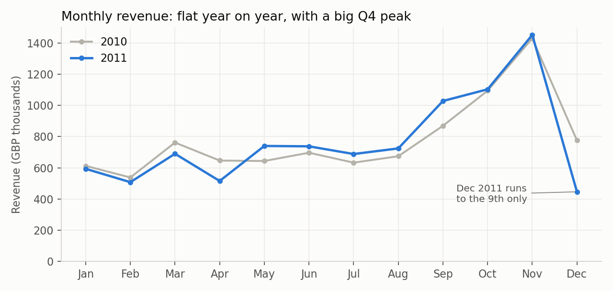
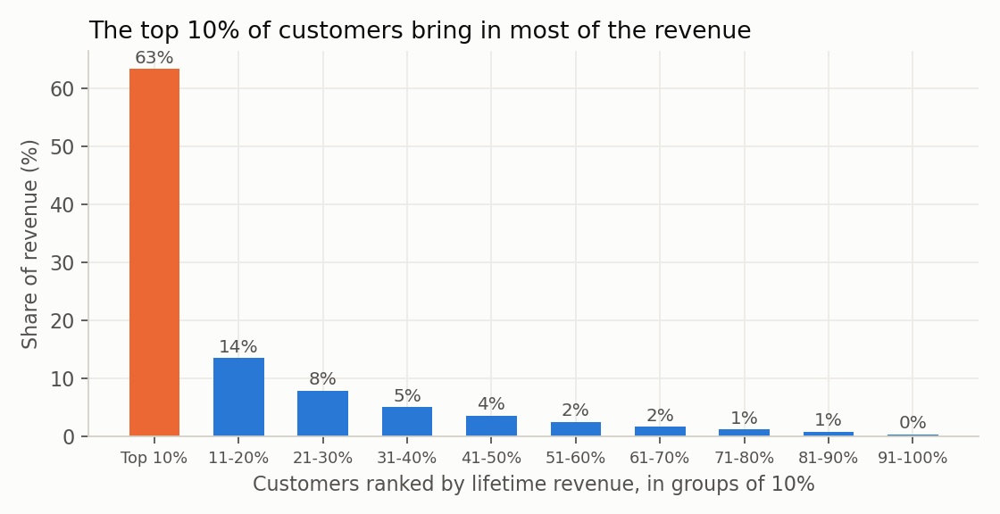
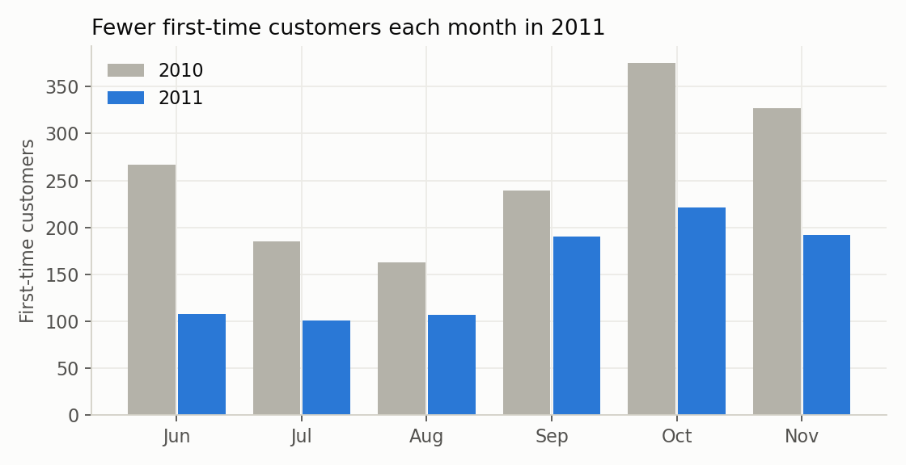
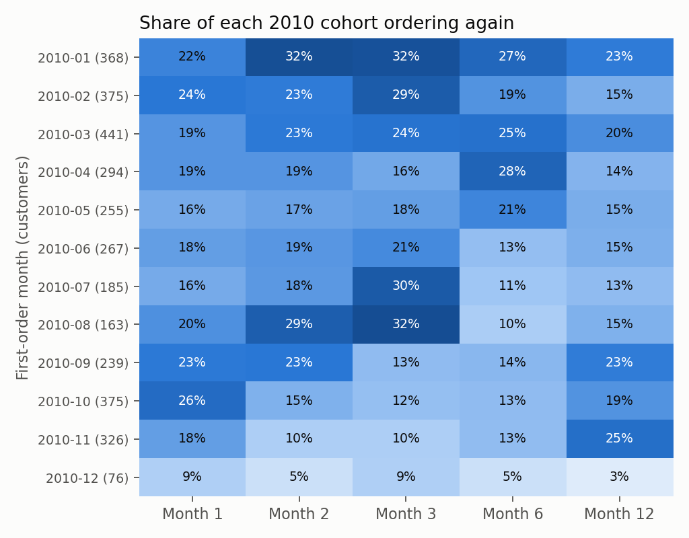
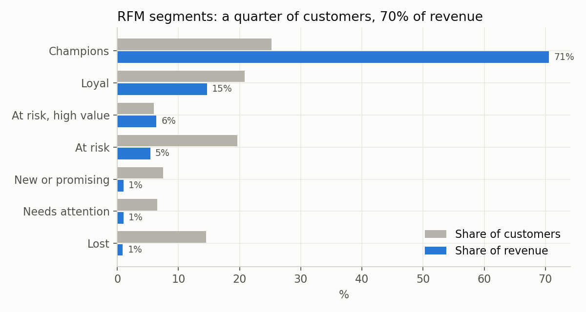

# Where does an online retailer's revenue really come from?

SQL analysis of 1 million transactions from a UK online gift wholesaler, December 2009 to December 2011.

**Result:** revenue looks healthy (flat, with a strong Q4), but it rests on a small and shrinking base. The top 10% of customers bring in 63% of revenue, first-time customers fell 41% year on year, and 349 once-valuable customers worth £1.07M have gone quiet. Retention and win-back matter more here than another sales push.

**Tools:** MySQL 8 (CTEs, window functions, conditional aggregation), Python for cleaning and charts



## The question

The business has two years of order data and a vague sense that things are fine. I wanted to answer four things a commercial manager would ask:

1. Is the business growing?
2. How dependent is it on a few customers?
3. Do new customers come back, and how fast?
4. Which customers should marketing treat differently?

## Data

[UCI Online Retail II](https://archive.ics.uci.edu/dataset/502/online+retail+ii) (Chen, 2019): 1,067,371 invoice lines from a UK-based online retailer that sells giftware, mostly to wholesalers. Each line has invoice, product, quantity, price, timestamp, customer ID and country.

## Cleaning

Raw transaction data is never ready to query. Full counts are in [data/cleaning_log.md](data/cleaning_log.md); the important calls were:

| Issue | What I did | Why |
|---|---|---|
| 34,335 exact duplicate rows | Dropped | The two yearly sheets overlap and some lines were keyed twice. |
| Postage, Amazon fees, bank charges, manual adjustments, test items, gift vouchers | Dropped (net −£75,749) | Not product sales. Amazon fees alone are −£261k. |
| Two orders of 74,215 and 80,995 units, each cancelled by the same customer within 20 minutes | Dropped both lines and their reversals | Entry errors. Left in, they made two random products look like best sellers and distorted two months. Real bulk orders (up to 19,000 units at 10p) were kept. |
| 22.6% of lines (13.3% of revenue) have no customer ID | **Kept** for revenue, excluded from customer analysis | Dropping them would understate sales by £2.6M. |
| Cancellations (invoice starts with C) | Kept, flagged `is_cancellation` | Needed for return-rate analysis, excluded from sales. |
| Data starts 1 Dec 2009 | Cohorts start Jan 2010 | Everyone who bought in Dec 2009 looks "new", including long-standing customers (left-censoring). |

The cleaned data goes into four tables: `orders`, `order_items`, `products`, `customers` ([schema](sql/01_schema.sql)). Every query starts from one view, `sales_lines`, so the "exclude cancellations" rule lives in [one place](sql/03_views.sql).

## Findings

### 1. Revenue is flat, and Q4 is everything
January to November revenue grew just **2.1%** (£8.60M to £8.78M). September to November brings in roughly 40% of the year's revenue. [q1](sql/analysis/q1_monthly_trend.sql)

### 2. The top 10% of customers bring in 63% of revenue
586 customers, about £18,200 each over two years. The bottom half of customers bring in less than 7% between them. [q2](sql/analysis/q2_customer_concentration.sql)



The UK is 90% of identified-customer revenue. Abroad, the Netherlands stands out: 22 customers averaging £25,000 each, with an average order of £2,545 against £421 in the UK. These look like a handful of large wholesale accounts. [q3](sql/analysis/q3_country_mix.sql)

### 3. Fewer new customers are coming in
Comparing June to November in both years (to avoid the start-of-data effect), first-time customers fell from **1,556 to 919, down 41%**. Some 2010 "new" customers may be old customers returning after a long gap, so the true drop is a little smaller, but the trend is clear across every month. Returning customers brought in 89 to 95% of monthly revenue through 2011. [q8](sql/analysis/q8_new_vs_returning.sql)



### 4. Customers come back fast or not at all
Of customers who first bought in 2010, **44% placed a second order within 90 days**, and 24% never came back. Monthly cohorts keep roughly 10 to 30% of customers active in any later month, which fits a wholesale business with regular restocking. [q5](sql/analysis/q5_cohort_retention.sql), [q7](sql/analysis/q7_second_order.sql)



### 5. RFM: a quarter of customers carry 71% of revenue
Scoring every customer 1 to 5 on recency, frequency and spend with `NTILE`:

| Segment | Customers | Share of revenue | Avg days since last order |
|---|---:|---:|---:|
| Champions | 1,476 | 70.6% | 20 |
| Loyal | 1,219 | 14.7% | 77 |
| At risk, high value | 349 | 6.4% | 343 |
| At risk | 1,145 | 5.4% | 410 |
| New or promising | 436 | 1.0% | 27 |
| Needs attention | 379 | 1.0% | 107 |
| Lost | 848 | 0.9% | 477 |

[q6](sql/analysis/q6_rfm_segments.sql)



### 6. A few products get sent back a lot
The regency cake stand leads on value cancelled (£16.5k, but only 5.5% of units). Some smaller lines have return rates over 25%: cherry lights (30 to 36%), tea time bunting (28%), and a pantry chopping board at 82%. [q4](sql/analysis/q4_returns.sql)

## Recommendations

1. **Give Champions account-level care.** 1,476 customers carry 71% of revenue. Losing a few dozen would hurt more than any campaign could fix. Early access to the Q4 range in August is a cheap way to lock in the peak.
2. **Run a win-back on the 349 "at risk, high value" customers.** They spent £1.07M with the business and haven't ordered in about a year. If one in five came back at their old pace, that's roughly £100k a year.
3. **Work on the second order.** The window is the first 90 days. A follow-up at day 30 to 45 for first-time buyers targets the 24% who never return.
4. **Find out why new-customer inflow dropped.** The data can't say whether it's marketing spend, a channel change or competition, but a 41% fall in first-time customers is the biggest long-term risk here.
5. **Check listings for high-return products.** Return rates above 25% usually mean a photo, size or description problem.

## Limitations

- No cost or margin data, so this is revenue, not profit.
- Customer country is the most common country on their orders.
- RFM uses the full two years. A rolling 12-month version would suit an ongoing dashboard better.
- The new-customer comparison is affected by the start of the data (explained above).

## Run it yourself

```bash
# 1. Download online_retail_II.xlsx from the UCI link above, then clean it
pip install pandas openpyxl matplotlib
python clean.py path/to/online_retail_II.xlsx

# 2a. In MySQL 8
mysql -u root -p < sql/01_schema.sql
mysql --local-infile=1 -u root -p < sql/02_load.sql
mysql -u root -p retail < sql/03_views.sql
# then run any file in sql/analysis/

# 2b. Or without MySQL: runs the same SQL files on SQLite
python run_queries.py
python make_charts.py
```

`run_queries.py` loads the data into SQLite and adds the three MySQL date functions the queries use (`DATE_FORMAT`, `DATEDIFF`, `PERIOD_DIFF`), so the SQL files run unchanged in both.

Data licence: CC BY 4.0, UCI Machine Learning Repository.
